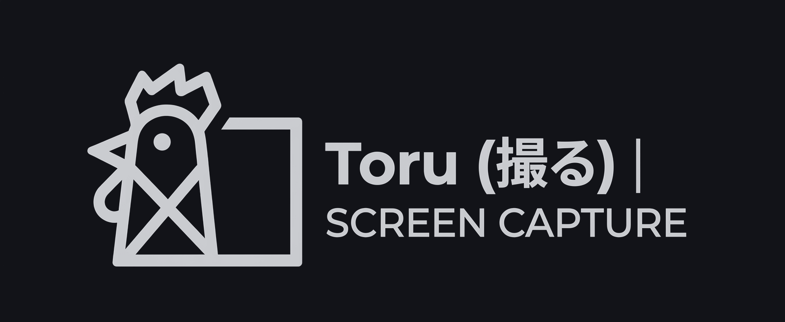

<p align="center"></p>

# Toru (撮る)

A macOS-style **screenshot, screen recording & game recording** tool for **Windows 11**.

Press <kbd>⊞</kbd> <kbd>Shift</kbd> <kbd>S</kbd> → pick a **region**, **window**, or **full screen** → annotate (or record) → **Done** auto-saves to your library.

> 撮る (*toru*) is the Japanese verb “to take a photo / shoot video.”

**Product site:** [stephenshorton.github.io/toru](https://stephenshorton.github.io/toru/)  
**Latest download:** [GitHub Releases](https://github.com/StephenSHorton/toru/releases/latest)

## Features

- **Global hotkey** capture (default Win+Shift+S; remappable)
- **Region / window / full screen** — window mode highlights on hover, click captures
- **Annotation editor** — overlay editor after a new shot; library items open in a window. Pen, shapes, arrows, text, emoji, crop, paste-as-layer
- **Library** — Done saves automatically; choose the folder in Settings. Views for All, Screenshots, Recordings and Clips (grouped by game); background and manual recordings open on a timeline to scrub and cut clips. Multi-select delete; a Send button on screenshot and recording cards. Optional: skip the editor and auto-save + copy
- **Aspect lock** — freeform, 16:9, 9:16, 4:3, 3:2, 1:1, 21:9 while resizing the region
- **Record & trim** — optional system / per-app / mic audio; Discord-friendly export; share as a link (catbox.moe, no account, links never expire, 200 MB cap); trim and crop in the clip editor; Home/End jump to the clip ends, I/O set them at the playhead
- **Game recording** — three modes: **Instant replay** (keeps the last few minutes, hotkey saves a clip), **Background recording** (whole sessions, optionally only while a game is in focus) and **Manual recording** (hotkey starts and stops). Needs a graphics card with a hardware encoder (NVIDIA, AMD or Intel). Saver / Standard / High / Custom quality presets, HEVC when the graphics card supports it, a storage limit that rolls the oldest sessions off. Background recording can also **keep the last** 30 min to 24 h of footage across all games and sessions (off by default: until storage is full); manual recordings are never deleted automatically. Clips land in `Videos\Toru Replays` sorted by game, with a chime and a corner toast
- **Recording hotkeys** (remappable) — Alt+F10 save instant replay, Ctrl+F11 start / stop recording, Ctrl+F12 add timeline marker
- **Recording audio** — game, Discord voice chat and microphone as separate sources with per-source volume; mic noise suppression (Off / Light / Strong); optional separate tracks for editing
- **Share your screen** to a browser on the same Wi-Fi (phone, tablet, TV) straight from the overlay
- **Freeze or live** overlay while selecting
- **Tray recents**, game-recording toggle, Send files…, auto-copy on capture; updates download in the background and announce themselves — restart when you like, or they install when you quit Toru
- **Send Files** — send any file, folder or capture peer-to-peer with a short spoken code like `7-guitarist-revenge`, end-to-end encrypted; the receiver uses Toru or `wormhole receive`, files land in Downloads by default, and the code doubles as a QR for phones
- **Auto Clicker** — click a mouse button or press a key at up to 500 (or 1,000) a second, at the cursor or through a list of picked screen points; Ctrl+Shift+Y starts and stops it (toggle or hold). Stops by itself at screen corners and edges, in stop zones you draw, on Alt+Tab or when the wrong app is in front; presets, including import from Blur AutoClicker. See [`docs/clicker.md`](docs/clicker.md)

## Download

| Asset | |
| --- | --- |
| `toru-*-windows-amd64-installer.exe` | Per-user installer (no UAC) |
| `toru-*-windows-amd64.zip` | Portable `toru.exe` |

Grab the latest from **[Releases](https://github.com/StephenSHorton/toru/releases/latest)**.

## Stack

| Layer | Choice |
| --- | --- |
| Shell | **Wails v3** + Go |
| Frontend | **React 19** + TypeScript + **shadcn/ui** + Tailwind |
| Editor | react-konva |
| Stills | DXGI (`kbinani/screenshot`) |
| Video | FFmpeg (`ddagrab` / gdigrab) |
| Transfer | magic-wormhole (`wormhole-william`) |
| Package manager | **bun** |

Design notes: [`docs/PLAN.md`](docs/PLAN.md). Send Files (file transfer): [`docs/send-files.md`](docs/send-files.md). Contributing: [`CONTRIBUTING.md`](CONTRIBUTING.md).

## Develop

### Prerequisites

- [Go](https://go.dev/dl/) (see `go.mod`)
- [Wails v3 CLI](https://v3.wails.io/): `go install github.com/wailsapp/wails/v3/cmd/wails3@v3.0.0-alpha.98`
- [Bun](https://bun.sh)
- WebView2 (ships with Windows 11)
- FFmpeg on `PATH` (or `TORU_FFMPEG`) for video
- NSIS for installer builds (`choco install nsis`)

### Quickstart

```sh
cd frontend && bun install && cd ..
wails3 dev
```

```sh
wails3 task windows:build PACKAGE_MANAGER=bun
```

## Release

```sh
git tag vX.Y.Z
git push origin vX.Y.Z
```

Tag push runs [`.github/workflows/release.yml`](.github/workflows/release.yml): builds the app + NSIS installer, publishes assets + `SHA256SUMS`. The in-app updater downloads newer releases in the background and announces them; restart when you like, or it installs when Toru quits.

## License

[MIT](LICENSE) © Stephen Horton and the Toru contributors.
