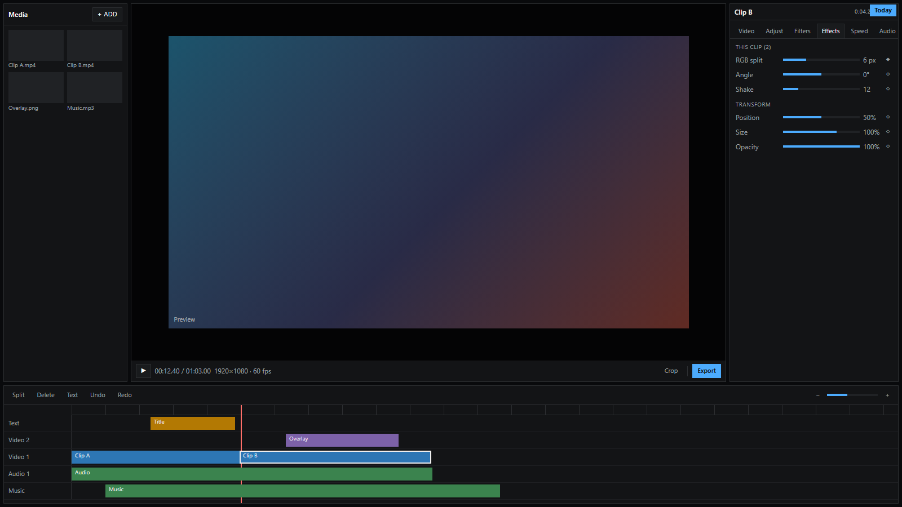
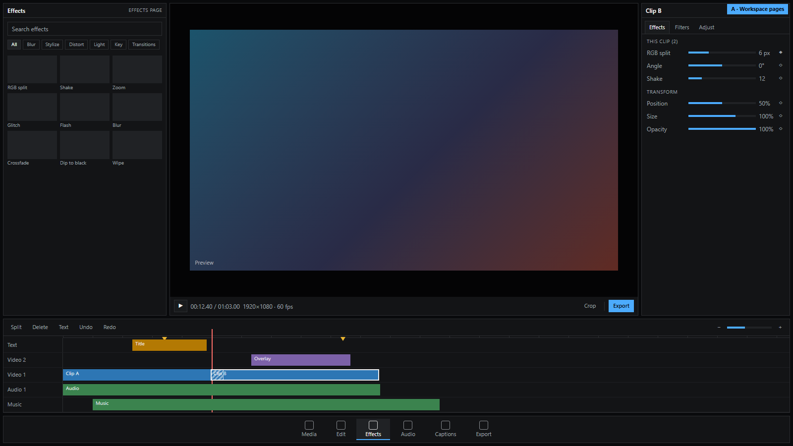
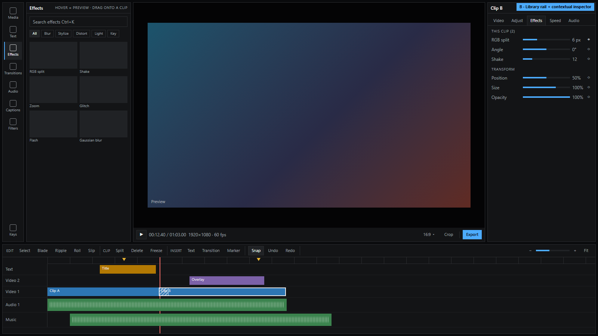
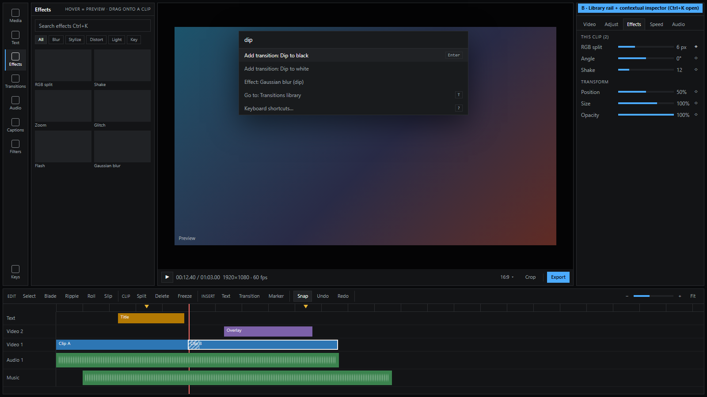
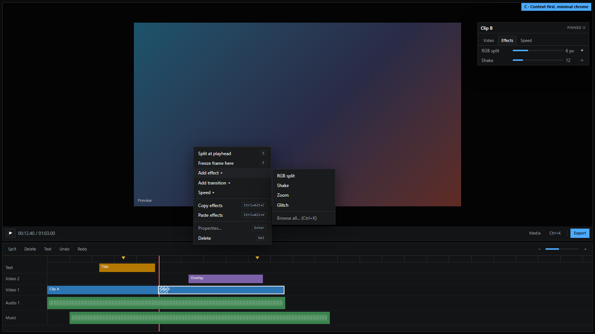

# Editor layout + feature roadmap (proposal)

Irori #111, for Blake to pick a direction. No code: the mockups are static
HTML (`docs/editor-layout/mockups.html`, `?v=now|a|b|bk|c`), screenshotted
at 1600×900 into `docs/editor-layout/*.png`.

Blake: *"there are still a ton of features that we need to add too, but I
don't want it to feel like clutter, and make it easy to navigate."*

**Decision (Blake, 2026-10-31): Option B**, the library rail + contextual
inspector, with right-click menus and the Ctrl+K palette. Build order: "If
B is picked" at the end.

## Where we are

There is one fixed screen: media bin | viewer | inspector (Video, Adjust,
Filters, Effects, Speed, Audio), with the timeline across the bottom. It
works today because there are few tools. Every new feature on the roadmap
below (transitions, captions, audio tools, markers, masks, canvas presets…)
has to go somewhere, and on this screen "somewhere" means another button in
the timeline bar, another inspector tab, or another dialog. That is how
clutter happens.

Three rules any option should keep:

1. **Show what's selected, hide what isn't.** The inspector only shows
   controls for the selected thing (clip, text, transition, track, nothing =
   the project).
2. **One place per kind of thing.** Libraries (things you add: media,
   effects, transitions, text styles, audio) are separate from properties
   (things you tune on what's selected).
3. **Every action has a keyboard path.** A command palette (Ctrl+K) lists
   every action with its shortcut. That way nothing needs a permanent button
   just to be findable.

## Option A: workspace pages

A page switcher along the bottom: **Media · Edit · Effects · Audio ·
Captions · Export**. Each page rearranges the same project for one job:
Effects has a big browser plus the effect inspector, Audio gets a mixer and
tall waveform tracks, Export gets presets and a queue. The timeline stays on
every page except Export.

- **Good:** very clean per page; scales to many big features (a full
  colour page, an audio mixer); familiar to people from pro editors.
- **Costs:** the most work (each page is its own layout); switching pages
  to do one small thing, like adding a fade while cutting, is friction for
  short game clips; a page with only two tools feels empty.

## Option B: library rail + contextual inspector (recommended)

One workspace.
- **Left icon rail:** Media, Text, Effects, Transitions, Audio, Captions,
  Filters. It opens **one** library panel at a time; click the same icon to
  collapse it and give the viewer the room.
- **Right inspector:** follows the selection.
- **Timeline toolbar:** grouped into Edit tools · Clip · Insert · Snap/Undo ·
  Zoom.
- **Ctrl+K palette:** reaches everything.

- **Good:** a new feature is usually just a rail entry (a library) or an
  inspector section (a property), so the screen never grows. Drag from a
  library onto the timeline is the natural flow for short-form editing. It's
  closest to today: the media bin becomes the first rail entry, and the
  inspector tabs stay. It can grow into A later: an "Export" or "Audio" page
  can be added if one ever needs a whole screen.
- **Costs:** one panel at a time means e.g. Media and Effects can't be open
  side by side (rarely needed); the rail needs clear icons + labels.

## Option C: context-first, minimal chrome

Only the viewer and the timeline stay on screen.
- **Right-click** on a clip, gap, track or the viewer is the main way to act
  (Split, Freeze, Add effect ▸, Add transition ▸, Speed ▸, Copy/Paste
  effects).
- **Inspector:** floats next to the selection and can be pinned.
- **Media:** a pop-over.
- **Ctrl+K:** the browser for everything else.

- **Good:** the most room for the picture; the fastest flow for someone who
  knows the shortcuts.
- **Costs:** poor discoverability, because a new user doesn't know what
  exists; browsing effects by look (thumbnails) is awkward in a menu; a
  floating inspector covers the picture.

C's pieces (right-click menus everywhere, Ctrl+K) are worth adding to A or
B anyway. They're listed in the roadmap below.

## Recommendation: B, plus C's context menus and palette

It fixes the clutter problem structurally: libraries on the left,
properties on the right, actions in menus and the palette. It's the smallest
change from today, and it suits Toru's short game-clip editing, where adding
things is the main job. A's pages stay possible later for Export or Audio,
if they ever outgrow a panel.

## Missing features, prioritised, and where they go (in B)

P0 = next, P1 = after, P2 = later. "Spec" points to `video-editor-v3.md`
where it's already planned.

| # | Feature | Pri | Where in B | Notes |
| --- | --- | --- | --- | --- |
| 1 | Transitions: crossfade, dip to black/white | P0 | Rail → Transitions; drag onto a cut; inspector shows duration/ease | Spec C8 |
| 2 | Audio waveforms on clips | P0 | Timeline (audio and video-with-audio clips) | Needed for cutting to the beat |
| 3 | Right-click menus on clips, gaps, tracks, viewer | P0 | Everywhere | Today: gap menu only |
| 4 | Command palette (Ctrl+K) + shortcuts sheet (?) | P0 | Overlay; rail → Keys | Lists every action and its shortcut |
| 5 | Multi-select (Shift/Ctrl+click, marquee), copy/paste clips, paste effects | P0 | Timeline; menus | Today: one clip at a time |
| 6 | Canvas presets 9:16 / 1:1 / 4:5, Fit/Fill, blurred background | P0 | Viewer bar "16:9 ▾"; project inspector (nothing selected) | Spec C9 |
| 7 | Text styling: stroke, shadow, box; text presets | P0 | Rail → Text (presets); inspector (styling) | Spec C9 |
| 8 | Markers (M), jump between markers | P1 | Timeline ruler; Insert group | Beat/moment marking |
| 9 | Trim tools: ripple, roll, slip | P1 | Timeline Edit group + keys | Ripple delete exists |
| 10 | J/K/L shuttle, frame step (←/→), in/out (I/O) | P1 | Keys only | No new buttons |
| 11 | Audio: normalise loudness, noise reduction, ducking music under voice | P1 | Rail → Audio (tools); inspector Audio tab | Spec C10 |
| 12 | Captions: auto-transcribe to timed text, style presets | P1 | Rail → Captions | Large; own spec |
| 13 | Zoom to fit, track height, collapse tracks | P1 | Timeline zoom group | |
| 14 | More transitions: wipes, slides, zoom, pixelize, glitch | P1 | Rail → Transitions | Spec C8 |
| 15 | Masks: blur/pixelate a region (names, chat) | P1 | Inspector → Effects (mask on effect) | Spec C11 |
| 16 | Export presets: 60 fps, quality, GIF/WebP, short-video presets | P1 | Export dialog | Spec C11 |
| 17 | Adjustment clips (effects over everything below) | P2 | Rail → Effects "Adjustment clip" | |
| 18 | Group/compound clips | P2 | Right-click → Group | |
| 19 | Templates (intro/outro packs) | P2 | Rail → Text / Media | |
| 20 | Proxy editing for large files | P2 | Settings + automatic | Reverse already uses a proxy |

## If B is picked: the order of work

1. Layout shell: rail + collapsible library panel; media bin moves into it;
   timeline toolbar grouped (no new features, same tools).
2. Ctrl+K palette and right-click menus (#3, #4), driven by the same action
   list as the agent commands, so each action is defined once.
3. Then features in the table's order; each lands as a rail entry or an
   inspector section.
